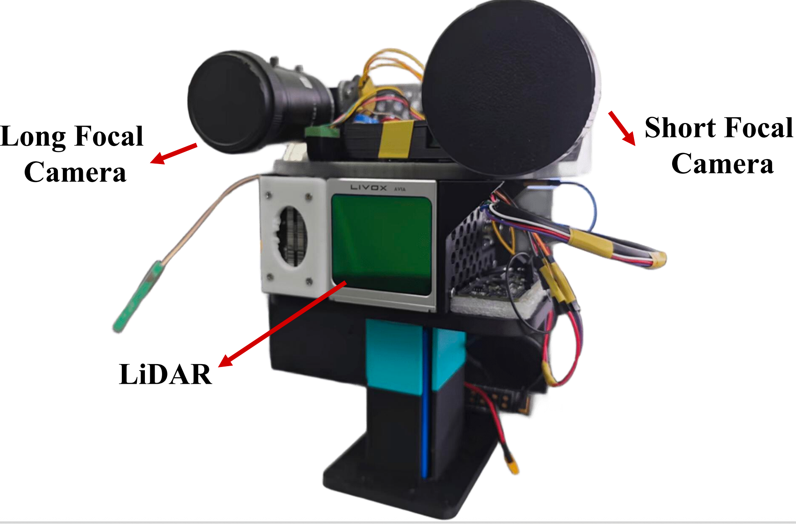
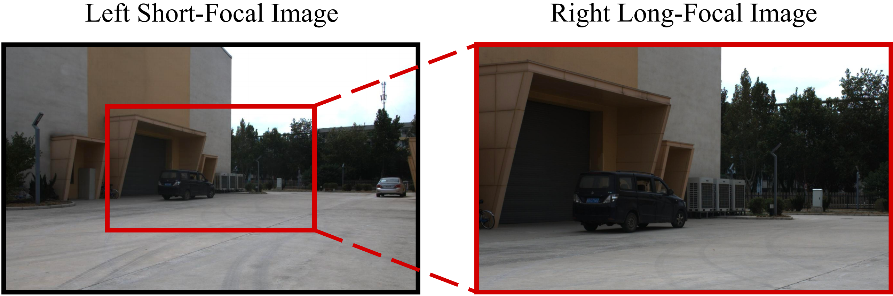
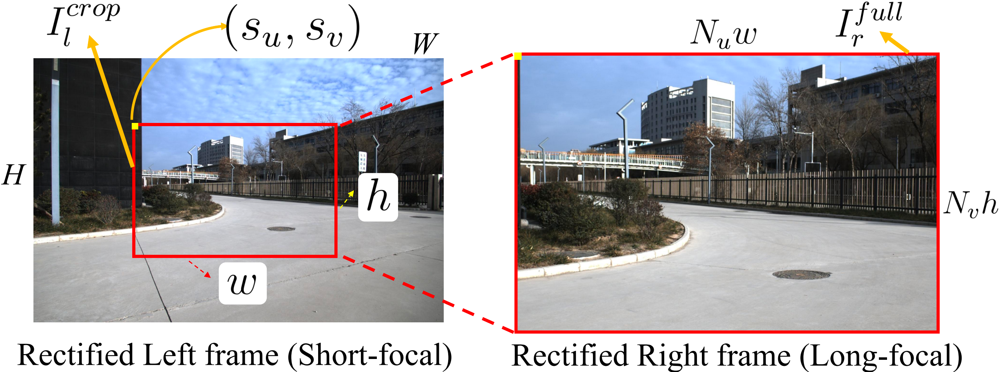
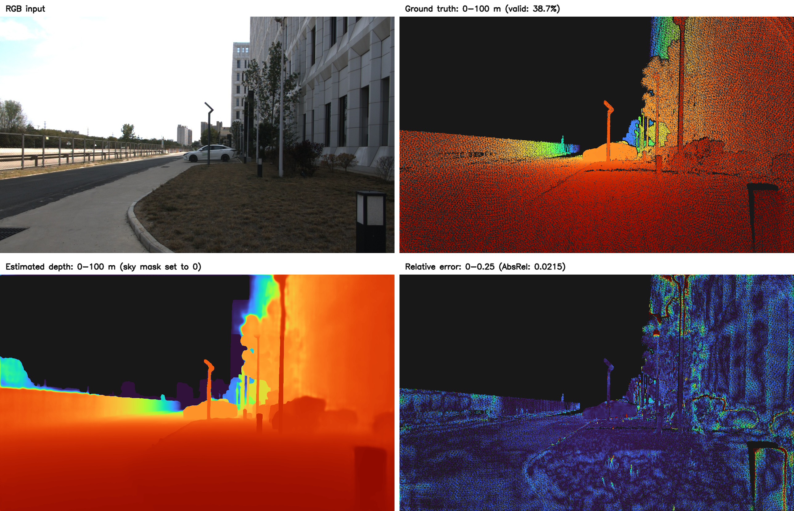

# Depth Estimation for Short-Long Focal Binocular Cameras

Official implementation of **Depth Estimation for Short-Long Focal Binocular
Cameras via LUT-Based Pseudo-3D Fusion**. DEforSLFBC combines the wide field of
view of a short-focal camera with accurate central depth cues from a long-focal
camera. It accepts one rectified `1280x768` left RGB image and one rectified
`1920x1152` right RGB image, and produces a full-frame metric depth map at the
left-image resolution.

The released inference pipeline works as follows:

1. The Depth Anything V2 monocular branch produces full-frame depth and
   quarter-resolution features.
2. The geometry-corrected IGEV-Stereo branch produces center-view disparity
   and probability features.
3. Disparity is converted to depth using `fb=146.98806411139032 px*m`.
4. The LUT-based pseudo-3D fusion network places the `640x384` stereo ROI at
   left-image coordinate `(x, y)=(320, 192)` and produces a `1280x768`
   full-frame depth map.

## Visual Overview

### Acquisition Platform

The CHU-LSStereo platform combines a short-focal camera, a long-focal camera,
and LiDAR for metric-depth supervision.

<p align="center">
  
</p>

### Captured and Rectified Image Pairs

The two cameras are hardware-synchronized and their original sensor frames are
captured at the **same native image dimensions**. Their focal lengths and
fields of view differ; the short-focal image covers the wider scene, while the
long-focal image resolves the central overlapping region more densely.

The different `1280x768` left and `1920x1152` right dimensions used by this
release are produced by adaptive rectification and resampling, not by unequal
native capture sizes. Rectification aligns the long-focal view with the
corresponding crop of the short-focal image.

<p align="center">
  
</p>

<p align="center">
  
</p>

### Evaluation Example

Bundled sample `000030` is shown as a 2x2 grid: RGB input (top left),
semi-dense LiDAR ground truth (top right), estimated depth (bottom left), and
relative-error map (bottom right). Ground-truth pixels are evaluated over
`0 < depth < 100 m`; pixels without valid LiDAR supervision are dark gray. The
displayed estimated depth has `sky_mask.png` pixels set to zero. Both depth
maps use the fixed `0-100 m` scale (near is warm, far is cool), and relative
error is clipped at `0.25`. This frame has `38.7%` valid ground-truth coverage.

<p align="center">
  
</p>

## Repository Layout

```text
checkpoints/                 Three independent inference checkpoints
docs/assets/                 Permanent README figures
src/deforslfbc/              End-to-end inference and fusion implementation
third_party/                 Monocular and stereo model implementations
test_data/                   100 release samples
infer.py                     Single-sample end-to-end inference
evaluate.py                  Release-set inference and metric evaluation
scripts/verify_release.py    Release integrity verifier
```

## Release Data

The selected samples from the source groups are interleaved into a single sequential namespace from
`000000` through `000099`. Each directory contains one complete, aligned sample:

```text
test_data/000000/
|-- left.png
|-- right.png
|-- ground_truth.png
`-- sky_mask.png
```

Ground truth is stored as uint16 PNG and decoded with:

```text
depth_m = pixel / 65535 * 300
```

Official metrics use pixels satisfying `0 < depth < 100 m`. `sky_mask.png` is
a uint8 full-frame mask aligned with the left image. Its resolution is
`1280x768`, and its values are 0 or 255.


## Checkpoints

The three checkpoints remain separate and are not merged:

| File | Branch | Purpose |
|---|---|---|
| `checkpoints/mono.pth` | Monocular | Full-frame monocular depth and features |
| `checkpoints/stereo.pth` | Stereo | Central disparity and probability features |
| `checkpoints/fusion.pth` | Fusion | Full-frame LUT-based depth fusion |

The checkpoint files contain only model states, architecture configuration,
and calibration metadata required for inference. Exact sizes and hashes are recorded in
`checkpoints/manifest.json`.

The original depthanything-v2 monocular checkpoint exceeds the 100 MB upload limit, so it is
distributed as a standard four-volume split ZIP:

| Volume | Size (bytes) |
|---|---:|
| `checkpoints/mono.pth.z01` | 99,614,720 |
| `checkpoints/mono.pth.z02` | 99,614,720 |
| `checkpoints/mono.pth.z03` | 99,614,720 |
| `checkpoints/mono.pth.zip` | 63,589,718 |

Keep all four volumes together in `checkpoints/` and do not rename them. With
7-Zip, WinRAR, Bandizip, or another archive manager that supports split ZIP
archives, double-click `checkpoints/mono.pth.zip` and select **Extract**. The
archive manager automatically reads the three `.z01`-`.z03` volumes. Select
`checkpoints/` as the destination so that the restored file is placed at:

```text
checkpoints/mono.pth
```

The operating system's built-in ZIP viewer may not support split archives. A
compatible archive manager is therefore recommended for double-click
extraction. If the `7z` command-line tool is installed, it can restore the
checkpoint directly:

```bash
7z x checkpoints/mono.pth.zip -ocheckpoints
```

Verify the reconstructed checkpoint before inference:

```bash
sha256sum checkpoints/mono.pth
# 9322c7a4eab0ae7cb8121216a406c8f5bcefed0f120e224febc518403c771c5d
```

## Environment

The release was verified with Python 3.11, PyTorch 2.10, and CUDA 12.8. The
recommended installation uses Conda for Python and pip CUDA wheels for
PyTorch; both steps are defined in `environment.yml`:

```bash
conda env create -f environment.yml
conda activate deforslfbc
```

If a different CUDA build is required, first install matching versions of
`torch` and `torchvision` using the official PyTorch instructions, then run:

```bash
pip install -r requirements.txt
```

CUDA is recommended for end-to-end testing. CPU mode can be used for model-load
checks, but full inference is slow.

## Single-Sample Inference

Run inference on a bundled sample:

```bash
python infer.py \
  --sample-dir test_data/000000 \
  --output outputs/demo \
  --device cuda:0
```

Custom inputs can also be provided explicitly:

```bash
python infer.py \
  --left /path/to/left.png \
  --right /path/to/right.png \
  --output outputs/custom \
  --device cuda:0
```

The output directory contains:

- `depth_m.npy`: float32 metric depth for downstream computation.
- `depth_m.pt`: the same depth map as a PyTorch tensor.
- `depth_color.png`: a quick preview over the 0-100 m range.
- `prediction.json`: input paths, output shape and range, and checkpoint
  provenance.

## Release-Set Evaluation

Run a quick one-sample validation:

```bash
python evaluate.py --limit 1 --output outputs/quick-check --device cuda:0
```

Evaluate all 100 bundled samples:

```bash
python evaluate.py --output outputs/test100 --device cuda:0
```

Add `--no-save-predictions` to retain only `metrics.json` instead of per-sample
depth outputs. The JSON report contains both aggregate and per-sample metrics.

## Release Verification

```bash
python scripts/verify_release.py
python scripts/verify_release.py --load-models --device cpu
python scripts/verify_release.py --run-inference --device cuda:0
```

The first command validates file hashes, image dimensions, sample uniqueness,
the date-free merged layout, sky masks, generated right phases, and checkpoint
contents. The second command also loads all three models strictly. The third
command performs a real end-to-end inference. Results are printed to stdout;
use `--report /path/to/report.json` only when a persistent JSON report is
needed.

## Input Constraints

The released weights are trained for fixed calibration, resolution, and ROI.
Custom inputs must use the same rectification and dimensions as the bundled
samples. The right input must be one unsplit `1920x1152` image; the inference
code performs the three-phase split. Ordinary unrectified stereo images cannot
be used directly.

## Citation

The paper was accepted by *IEEE Robotics and Automation Letters* in September
2026. The DOI, volume, issue, and page range are not yet available; update the
placeholder note below when the final bibliographic record is published.

```bibtex
@article{wang2026deforslfbc,
  title   = {Depth Estimation for Short-Long Focal Binocular Cameras via
             LUT-Based Pseudo-3D Fusion},
  author  = {Wang, Ke and Feng, Yaohui and Wu, Bingcao and Liu, Zhanwen and
             Shen, Shaojie},
  journal = {IEEE Robotics and Automation Letters},
  year    = {2026},
  note    = {Accepted September 2026; DOI and final publication details to appear}
}
```
